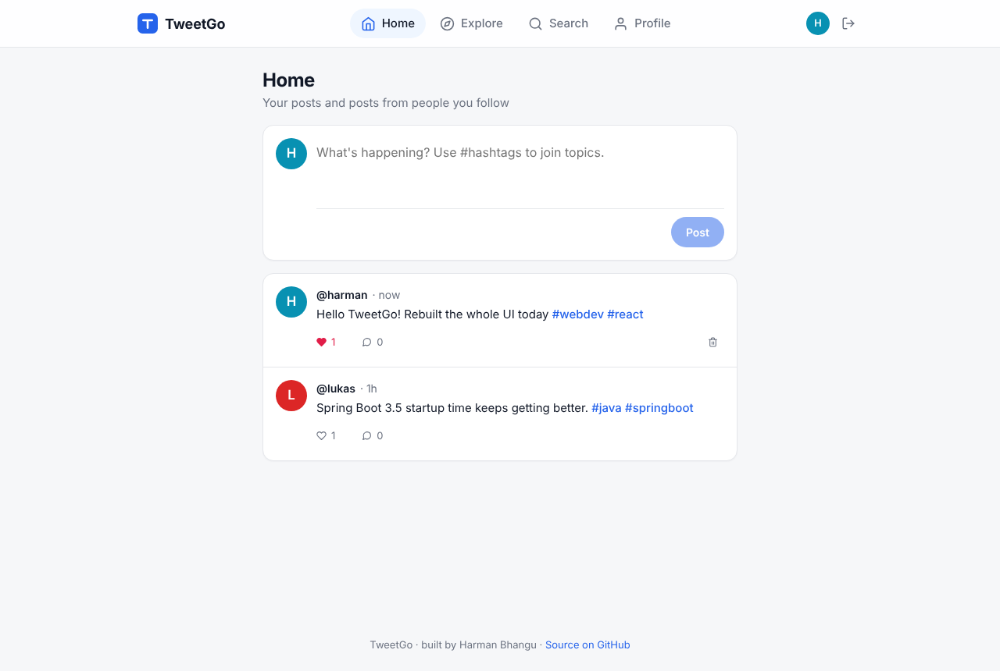
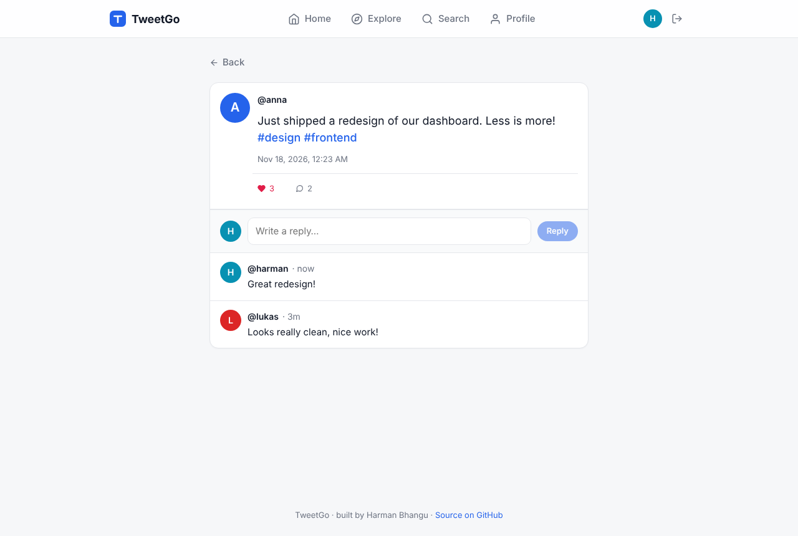
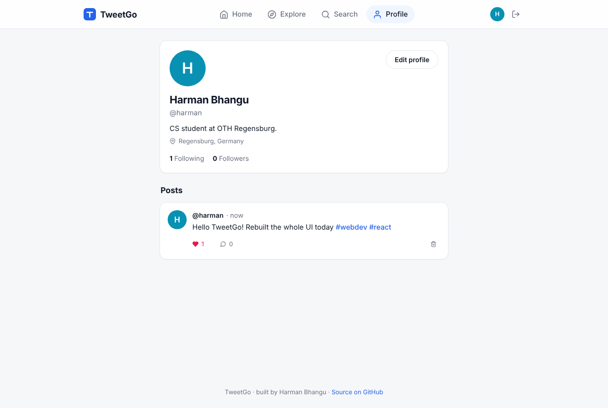
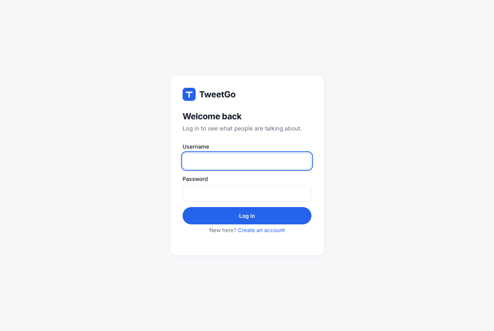
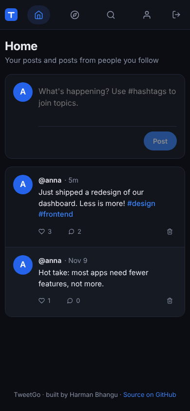

# TweetGo

[](https://github.com/Harry24x/Tweetgo/actions/workflows/backend-tests.yml)

A full-stack microblogging platform (Twitter-like) with a React frontend and a Spring Boot REST API.
Built as a solo project for the Web Technology Project course at OTH Regensburg, then redesigned with a clean, minimal UI and a round of bug fixes.

<p align="center">
  
</p>

## Tech stack

| Layer | Technologies |
|---|---|
| Frontend | React 19, JavaScript, React Router, Axios, Vite, plain CSS (light + dark mode) |
| Backend | Java 21, Spring Boot 3.5, Spring Security, JWT, Spring Data JPA, Bean Validation |
| Database | MariaDB (H2 in-memory for tests) |
| API docs | Swagger / OpenAPI (springdoc) |
| Testing | JUnit 5, Mockito, MockMvc |
| Deployment | Docker, Docker Compose, Nginx |

## Features

- Registration and login with JWT authentication
- Create, view and delete posts
- Like / unlike posts and comment on posts
- Follow / unfollow users, user search and profile editing
- Hashtags with a hashtag feed
- Home feed (your posts + people you follow) and an Explore feed with everyone's latest posts
- Post detail page with replies
- Paginated timelines ("Show more")
- Responsive, minimal UI with automatic dark mode

## Screenshots

| Post with replies | Profile |
|---|---|
|  |  |

| Login | Mobile (dark mode) |
|---|---|
|  |  |

## Architecture

```
React (Vite, served by Nginx) ──HTTP/JSON──▶ Spring Boot REST API ──JPA──▶ MariaDB
                                              │
                                              └─ JWT filter (Spring Security)
```

The backend exposes 19 REST endpoints under `/api/auth`, `/api/users` and `/api/tweet`.
Interactive API documentation is available in Swagger UI while the backend is running.

<details>
<summary><strong>API endpoints</strong></summary>

| Method | Endpoint | Description | Login needed |
|---|---|---|---|
| POST | `/api/auth/register` | Create an account | – |
| POST | `/api/auth/login` | Log in, returns a JWT | – |
| GET | `/api/users/me` | Your own profile | ✓ |
| PUT | `/api/users/me` | Update name, bio, location | ✓ |
| GET | `/api/users/{username}` | A user's profile | ✓ |
| GET | `/api/users/search?q=` | Search users by username | ✓ |
| POST | `/api/users/{username}/follow` | Follow a user | ✓ |
| POST | `/api/users/{username}/unfollow` | Unfollow a user | ✓ |
| POST | `/api/tweet` | Create a post (max. 280 characters) | ✓ |
| GET | `/api/tweet/feed?page=` | Home feed: your posts + people you follow | ✓ |
| GET | `/api/tweet/explore?page=` | Latest posts from everyone | – |
| GET | `/api/tweet/user/{username}?page=` | A user's posts | – |
| GET | `/api/tweet/hashtag/{name}?page=` | Posts with a hashtag | – |
| GET | `/api/tweet/{id}` | One post | – |
| DELETE | `/api/tweet/{id}` | Delete your own post | ✓ |
| POST | `/api/tweet/{id}/like` | Like a post | ✓ |
| DELETE | `/api/tweet/{id}/unlike` | Remove your like | ✓ |
| GET | `/api/tweet/{id}/comments?page=` | Replies to a post | – |
| POST | `/api/tweet/{id}/comments` | Reply to a post (max. 500 characters) | ✓ |

Lists are paginated with 20 items per page. Errors are returned as JSON, for example
`{"message": "Tweet not found with ID: 5"}` with status 400, 401 or 404.

</details>

## Run with Docker (recommended)

Requirements: Docker and Docker Compose.

```bash
git clone https://github.com/Harry24x/Tweetgo.git
cd Tweetgo
cp .env.example .env        # Windows: copy .env.example .env
# open .env and set DB_PASSWORD and JWT_SECRET (min. 32 characters)
docker compose up -d --build
```

The first build downloads Maven and Node dependencies and takes a few minutes. Stop everything with `docker compose down`.

| Service | URL |
|---|---|
| Frontend | http://localhost |
| Backend API | http://localhost:8080 |
| Swagger UI | http://localhost:8080/swagger-ui.html |
| Adminer (DB admin) | http://localhost:8081 |

## Run locally for development

Backend (needs a running MariaDB, for example `docker compose up -d db`):

```bash
cd tweetgo-backend
export SPRING_DATASOURCE_PASSWORD=<your DB_PASSWORD>
export JWT_SECRET=<your JWT_SECRET>
./mvnw spring-boot:run      # Windows: mvnw.cmd spring-boot:run
```

Frontend:

```bash
cd tweetgo-frontend
npm install
npm run dev                 # http://localhost:5173
```

The frontend calls the API at `http://localhost:8080` by default. To use another backend, copy `tweetgo-frontend/.env.example` to `.env` and change `VITE_API_URL`.

## Configuration for hosting

| Setting | Where | Default |
|---|---|---|
| `VITE_API_URL` | frontend build (env var or Docker build arg) | `http://localhost:8080` |
| `CORS_ALLOWED_ORIGINS` | backend env var, comma separated frontend URLs | `http://localhost,http://localhost:80,http://localhost:5173` |

## Tests

85 unit and integration tests cover controllers (MockMvc), services, entities, DTO validation and JWT security.
Tests use an in-memory H2 database, so no MariaDB is needed.

```bash
cd tweetgo-backend
./mvnw test
```

## Project structure

```
tweetgo-backend/    Spring Boot API (controllers, services, repositories, security, DTOs)
tweetgo-frontend/   React app
  src/pages/        Login, Register, Home, Explore, Search, Profile, Post, Hashtag
  src/components/   Layout, post card, feed, composer, follow button, avatar
  src/api.js        Axios client (JWT header, session-expiry handling)
  src/styles.css    Design tokens, light/dark theme, responsive layout
docs/screenshots/   Screenshots used in this README
docker-compose.yml  MariaDB, Adminer, backend and frontend services
```

## Author

Harman Bhangu · B.Sc. International Computer Science, OTH Regensburg · [GitHub](https://github.com/Harry24x)
